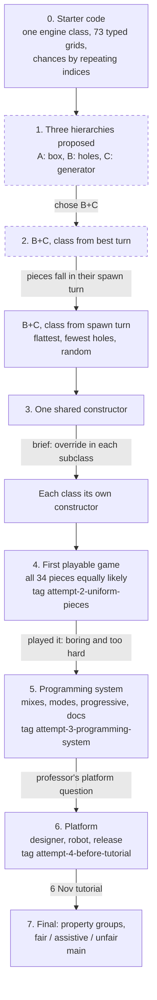

# AI usage report

CS F301 PoPL, ExTetris assignment. This report follows section 2.2 of the
brief.

> **How this report was written.** At my request ("wrap up the AI usage report
> yourself on my behalf", log Entry 23), the AI assistant drafted this report
> from the interaction log ([ai_log/raw_log.md](ai_log/raw_log.md)) and the
> project history. It is written in my voice. It describes only what the log
> and the repository show: what I asked, what I decided and what I checked. I
> have reviewed it before submitting.

## Contents

1. [Tool and way of working](#1-tool-and-way-of-working)
2. [Timeline](#2-timeline)
3. [Phase by phase](#3-phase-by-phase) (the eight items for each phase)
4. [Earlier and less successful attempts](#4-earlier-and-less-successful-attempts)
5. [Where the AI's work had to be corrected](#5-where-the-ais-work-had-to-be-corrected)
6. [Effort with and without AI](#6-effort-with-and-without-ai)
7. [Overall strengths, weaknesses and lessons](#7-overall-strengths-weaknesses-and-lessons)
8. [About "verbatim responses"](#8-about-verbatim-responses)

### Where to find each item the brief asks for

| the brief asks for (section 2.1, 2.2, 3.1) | where it is |
|---|---|
| entity-relationships | [design.md §2b](design.md#2b-entityrelationship-diagram) (ER diagram) |
| use cases, UML | [design.md §2a](design.md#2a-use-cases-who-uses-extetris-and-for-what) (use cases), [§3](design.md#3-class-diagram) (class diagram), [§4](design.md#4-what-happens-when-you-press-space) (sequence diagram), [§1a](design.md#1a-what-kind-of-product-is-this) and [§2](design.md#2-the-layers) (product and layer diagrams) |
| the division of labour, additional methods, "hair and limbs" | [design.md §3a](design.md#3a-the-division-of-labour-who-does-what-hair-and-limbs) |
| how the class hierarchy gives flexibility without programming burden | [design.md §3b](design.md#3b-how-the-hierarchy-takes-work-off-the-application-programmer), [§5](design.md#5-key-design-decisions) |
| 1. prompts, verbatim | [ai_log/raw_log.md](ai_log/raw_log.md) (all 40 entries); quoted in section 3 below |
| 2. responses, verbatim | the attached transcripts (section 8); summaries in the log |
| 3.–8. interpreted, planned, implemented, got, how, strengths/weaknesses | section 3 below, for every phase |
| earlier attempts, the evolution of the project and my learning | section 4 (table and diagram), section 7 (lessons) |
| effort with AI against without or proscribed | section 6 |
| API documentation | [api.md](api.md) (generated from the code) |
| Game Programmer's Manual | [manual.md](manual.md) |
| build and run scripts | `play.*`, `design.*`, `Makefile` ([README](../README.md)) |

---

## 1. Tool and way of working

| | |
|---|---|
| AI tool | Claude Code (model Claude Opus 5.5), in the Claude desktop app, working directly in my project folder |
| What it could do | read files, write code and documents, run commands and tests, use a built-in browser, push to my GitHub |
| Ground rules I set at the start | 1. keep the starter code untouched; 2. build in `src/extetris/`; 3. use Python 3, numpy and tkinter only; 4. log every prompt; 5. work in phases and **stop at each checkpoint** for my decision |

I directed the work through prompts, chose between options at checkpoints,
and verified results by running the tests and playing the game. **I did not
write or edit code myself.** All code and documents were written by the AI.

## 2. Timeline

From the log timestamps (IST). Everything up to Entry 32 was on 22 November
2026:

| time | phase | log entries |
|---|---|---|
| 06:00 – 06:20 | Phase 1: analysis; then I asked for plain-language explanations | 1 – 4 |
| 15:34 – 15:54 | design decisions for the piece hierarchy; Phase 2: pieces | 5 – 13 |
| 15:58 – 16:01 | Phase 3: board; GitHub set up | 14 – 15 |
| 16:07 – 16:16 | Phase 4: engine and window; Phase 5: piece mixes | 16 – 20 |
| 17:12 – 17:16 | Phase 6: documentation; Phase 7: run scripts | 21 – 22 |
| 17:20 – 17:25 | this report; transcript export | 23 – 25 |
| 17:27 – 17:30 | the professor's variant / platform / system question | 26 – 28 |
| 17:30 – 17:40 | Phase 8: the platform layer | 29 – 30 |
| 17:42 – 17:51 | I tried the Variant Designer by hand | 31 – 32 |
| 26 Nov | review against the professor's note on reporting; this report's [attempts section](#4-earlier-and-less-successful-attempts) added; a starter file restored | 33 – 36 |
| 26 Nov | asked what else to improve; checked the project against the 6 Nov tutorial video; Phase 9 | 37 – 39 |
| 26 Nov | pushed Phase 9; exported both transcripts, removed personal details from them and put them in one zip | 40 |

The working session took about **2½ hours** in total, in two blocks. On top of
that came my own time reading the explanations, playing the game and reviewing
documents: **about 4 hours**.

## 3. Phase by phase

Each phase is reported under the eight items the brief asks for:

1. prompt
2. response
3. what I interpreted
4. what I planned
5. what was implemented
6. what I got
7. how I got it
8. strengths and weaknesses

Full prompts are in the log; short ones are quoted here.

### Phase 1: Analysis of the starter code (Entries 1–4)

1. **Prompt:** a long prompt (verbatim in Entry 1). It set the ground rules
   and asked for:
   - a script that removes duplicate shapes (under rotation, and under
     rotation plus reflection);
   - groups by bounding box and by edge/corner contact;
   - hole counts per orientation;
   - a bug list;
   - `docs/analysis.md`;
   - then a stop to propose 2–3 class hierarchies *without choosing*.
2. **Response:**
   - It wrote `tools/shape_census.py` and `docs/analysis.md`.
   - It reported:
     - the 73 matrices are 34 distinct shapes under rotation, 22 with
       reflection;
     - an independent enumeration confirmed the set is complete;
     - 10 bugs, 3 fragile imports and 8 design limitations.
   - It proposed three hierarchies (by bounding box, by holes, by a generator)
     and stopped.
   - It also pointed out that the starter files were at the project root, not
     in an `extetris/` folder as my prompt said.
3. **Interpreted:** honestly, at first I did not follow it. My next prompt was
   *"i don't understand anything happening here"*. I then asked it to *"Walk
   through the findings"* and *"Explain the 3 options"*. Its re-explanations,
   with small drawings and a Lego-sorting analogy, are what I worked from. The
   key points I took:
   - most of the 73 entries are the same piece turned;
   - "holes" is a measure of how awkward a piece is;
   - the starter has real bugs, e.g. a blocked rotation can mirror a piece.
4. **Planned:** I did not plan anything yet; I first needed to understand the
   options.
5. **Implemented:** analysis only (script and report). No engine code.
6. **Got:** working analysis numbers that later phases tested against.
7. **How:** worked as delivered. Some bugs (e.g. pieces leaving the left edge,
   extra timers when pressing Down while paused) were reproduced by the AI
   with small test runs, not just claimed.
   - Two items I had expected to be crashes ("missing imports") turned out to
     work by accident. The AI reported them as fragile, not as crashes, which
     corrected my assumption.
8. **Strengths:** thorough, checkable, every claim backed by a script or a
   reproduction. **Weakness:** the first write-up was too technical for me; it
   took three more prompts before I could make decisions.

### Design decisions for the piece hierarchy (Entries 5–8)

1. **Prompts:**
   - *"can I use somewhat as a mixture of B and C"*
   - answers to four follow-up questions (*"b)"*, *"keep separate for now"*,
     *"just auto names"*, *"keep this on hold"*)
   - *"Flattest turn"*
   - *"Random between ties"*
2. **Response:**
   - It confirmed a mixture works: a generator builds the pieces (C) and
     difficulty classes form the hierarchy (B).
   - Each choice raised a consequence it flagged. For example, choosing
     "spawn turn" needed a rule for *which* turn.
   - It checked that "flattest turn, then fewest holes" gives exactly the same
     classes as "best turn".
3. **Interpreted:** I wanted the hierarchy to reflect difficulty, which is
   what the brief means by "holes produced while landing", without typing in
   any grids.
4. **Planned:** my decisions:
   - B+C;
   - a piece's class comes from its **spawn turn**;
   - the spawn turn is the **flattest**, then the one with fewest holes, then
     **random** between ties;
   - hole classes kept separate;
   - automatic names;
   - no edge/corner sub-level for now.
5. **Implemented:** nothing yet; decisions only.
6. **Got:** a fully specified design: 6 classes with 5, 10, 11, 3, 4 and 1
   pieces.
7. **How:** each decision came from options the AI laid out. I picked one at
   every step, mostly but not always its first-listed option.
8. **Strengths:** small decisions, each with its consequence explained.
   **Weakness:** the options were the AI's framing; I did not research
   alternative rotation systems or classifications on my own.

### Phase 2: Pieces (Entries 9–13)

1. **Prompts:**
   - *"Yes, start Phase 2"*
   - running the tests and the catalogue myself
   - *"would does the assignment ask for"* and *"what are the pros of each
     having its own constructor"*
   - *"Give each its own"*
2. **Response:**
   - It built the generator, an immutable `Shape`, the six difficulty classes,
     the spawn rule and the names, plus 28 tests.
   - It flagged that the classes shared one constructor, while the brief says
     constructors "must be overridden in each subclass".
   - On my request it explained the brief's wording and the pros of
     per-class constructors.
   - It then gave every class its own documented constructor (32 tests).
3. **Interpreted:** the brief's wording matters for grading, and per-class
   constructors also demonstrate overriding and `super()`, which are core PoPL
   ideas.
4. **Planned:** follow the brief literally, but make each override meaningful
   (its own documentation and checks), not empty copies.
5. **Implemented:** `src/extetris/geometry.py`, `generator.py`, `shape.py`
   and `pieces.py`; `tests/test_pieces.py`.
6. **Got:** it worked.
   - I ran the 28 (later 32) tests: all OK.
   - The catalogue showed the expected 5 / 10 / 11 / 3 / 4 / 1 pieces.
   - I checked the help text.
   - One cosmetic slip ("1 pieces") was fixed after I shared the output.
7. **How:** no changes by me. My contribution was the constructor decision
   and the verification runs.
8. **Strengths:**
   - no hand-typed grids at all;
   - pieces can't be changed after creation, so the starter's
     rotation/mirroring bugs are impossible;
   - the generated set is tested to equal the starter's.

   **Weakness:** the six constructors are similar to each other (a trade-off
   I accepted).

### Phase 3: The board, and GitHub (Entries 14–15)

1. **Prompts:**
   - *"okay phase 3 let's build the game board"*
   - mid-task: *"also start pushing this on github coz why not don't show
     claude"*
   - then answers about the repository (public, starter code but no PDF, name
     "extetris", author "mayankbhojwani", noreply email)
2. **Response:**
   - It built an immutable `Board` with 26 tests.
   - It took "don't show claude" to mean no AI co-author lines in commits, but
     kept the AI log in the repository because the brief requires reporting.
   - It warned me that a public repository can be copied by classmates and
     that my Gmail would be visible in commits; I chose the noreply address.
   - Before publishing, it removed my computer's folder path from the log.
3. **Interpreted:** the board needed to fix the starter's edge bug and line up
   rows properly.
4. **Planned:** let the AI choose the board design; publish publicly.
5. **Implemented:** `src/extetris/board.py`, `tests/test_board.py`, git setup,
   the first commit.
6. **Got:** all 58 tests passed. I checked the board drawing and the landing
   position myself in the terminal.
7. **How:** one test failed on the first run because the AI wrote the wrong
   expected value in the test (2 instead of 3); the code was right. It found
   and fixed this itself.
8. **Strengths:** a cross-check test shows the board's hole count agrees with
   every piece's hole count from Phase 1. **Weakness:** I made the board
   design decisions by default, not consciously.

### Phase 4: Game engine and window (Entries 16–17)

1. **Prompts:**
   - *"let's wrap up the game engine and window first"*
   - playing the game several times
   - *"they cant go through wals"*
2. **Response:**
   - It separated the rules (`Game`, no tkinter) from the window
     (`GameWindow`).
   - It fixed the starter's pause typo, extra-timer bug, never-set game-over
     flag and skipped speed-ups.
   - It added wall kicks, a hard drop that locks immediately, and colours by
     difficulty class.
   - 20 new tests, including random-play "fuzz" tests.
3. **Interpreted:** separating rules from the window is what makes the engine
   testable and reusable.
4. **Planned:** I asked for the engine and window before the piece
   frequencies. I didn't set any rules for the engine myself; the AI kept the
   starter's defaults (1 second fall, speed-up every 100 lines), and I
   accepted them.
5. **Implemented:** `game.py`, `window.py`, `play.py`, `tests/test_game.py`.
6. **Got:** all 78 tests passed. **I played it:** pieces stop at both walls.
7. **How:** one window test failed at first: two timers instead of one. The
   AI traced it to its own timer code and fixed it.
8. **Strengths:** the starter's bugs are each covered by a test. **Weakness:**
   the speed-up every 100 lines is rarely reached, and wall kicks are a simple
   fixed list.

### Phase 5: Which pieces appear, and how often (Entries 18–20)

1. **Prompts:**
   - *"it seems fine but do we have to use all these type of pieces kinda
     makes the game boring?"*
   - *"Yes, A + B + C"*
   - *"Keep as is"*
2. **Response:**
   - It explained that all 34 pieces equally likely was only a placeholder,
     and that the starter's own default was the 7 classics.
   - It proposed custom mixes (A), ready-made modes (B) and a mix that gets
     harder with lines cleared (C), all built as functions inside objects.
   - It flagged that "hard" (1.76 average holes) is close to "chaos" (1.85).
3. **Interpreted:** my "boring" feedback and the brief's second requirement
   (replace "repeat the index") were the same problem.
4. **Planned:** build all three. Make the default game start like classic
   Tetris and get harder. Keep the AI's first-guess weights.
5. **Implemented:** `mixes.py` (`PieceMix`, `mix`, `only`, `MODES`,
   `progressive`), a Pieces menu, a `--mode` option, 21 tests.
6. **Got:** all 99 tests passed.
7. **How:** worked first time.
8. **Strengths:**
   - designers write chances by name;
   - the functional-OO design combines freely;
   - a test checks the modes really get harder in order.

   **Weakness:** the mode weights were not tuned by playtesting.

### Phase 6: Documentation (Entry 21)

1. **Prompt:** *"Documentation"*.
2. **Response:**
   - It wrote the Game Programmer's Manual, a design document with UML class,
     layer and sequence diagrams, a generated API reference, three example
     variants and a README.
   - It added a test that runs every example and manual snippet.
3. **Interpreted:** the brief calls documentation the most important part,
   and the manual must suit non-programmers.
4. **Planned:** I chose documentation as the next phase from the remaining
   items the AI listed from the brief (UML design documents, API
   documentation, a Game Programmer's Manual). I set no further requirements.
5. **Implemented:** `docs/manual.md`, `docs/design.md`, `docs/api.md` (via
   `tools/make_api_docs.py`), `examples/`, `README.md`.
6. **Got:** all 103 tests passed. The diagrams were checked to render.
7. **How:** the generated reference first showed 21 undocumented methods; the
   AI added descriptions to them. It also simplified some diagram syntax so
   the diagrams would render.
8. **Strengths:** the API reference is generated from the code, so it cannot
   drift. **Weakness:** I have not yet had someone unfamiliar with the
   project try the manual.

### Phase 7: Run scripts (Entry 22)

1. **Prompt:** *"also build the scripts after this i'll be back"*.
2. **Response:**
   - Launchers: `play.command` (macOS double-click), `play.bat` (Windows),
     `play.sh`, and a `Makefile`.
   - A setup check that explains how to install anything missing.
3. **Interpreted:** a game designer should be able to start the game without
   a terminal.
4. **Planned:** I let the AI finish this phase without a checkpoint because I
   was away.
5. **Implemented:** the scripts, plus `play.py --check`.
6. **Got:** on macOS all launchers opened the game. **`play.bat` was not
   tested**, as no Windows machine was available.
7. **How:** the AI's first automatic launch test hung (a problem in the test,
   not the game). It stopped it and redid the test correctly.
8. **Strengths:** clear error messages instead of crashes. **Weakness:**
   Windows is untested.

### Phase 8: The platform layer (Entries 26–30)

1. **Prompts:**
   - a pasted question from the course: is the design a game variant, a
     variant development platform, or a variant programming system?
   - *"give me a brief answer"*
   - *"was I supposed to build a platform as per the pdf"*
   - *"Yes, build it"*
2. **Response:**
   - It said what we had was a **programming system**: a library with an
     API, with `play.py` and the examples as variants built on it.
   - It said this was not a platform, because a designer still had to edit
     Python and had no way to preview, test or package a variant.
   - It pointed out that the PDF's "first and foremost requirement" (design
     and release a variant without programming, like Jupyter on Colab)
     amounts to a platform with the system inside it.
   - It then built that platform:
     - a variant file format with plain-language checks;
     - the **Variant Designer** window: a form, a live preview, and Play,
       Robot playtest, Release and Save buttons;
     - a robot playtester;
     - a release packager that makes a shippable zip with launchers and an
       auto-written README;
     - four sample variants, `design.*` launchers, and
       `play.py --variant/--release`.
3. **Interpreted:** the system part met section 1.2 of the brief, but section
   3, the top requirement, needed a platform. Having a system was not enough
   to claim the main requirement.
4. **Planned:** build the platform with the system as its inside layer,
   using only Python, numpy and tkinter. I didn't use Jupyter, because it
   would be an extra dependency.
5. **Implemented:**
   - `src/extetris/variant.py`, `designer.py`, `playtest.py`, `release.py`;
   - `Game.drop_at` (used by the robot);
   - `design.py` and its launchers, `variants/*.json`;
   - updates to the manual (the designer is now the main way), the design
     document (product type and platform diagrams), the README and the API
     reference;
   - `tests/test_platform.py`.
6. **Got:** all 127 tests passed.
   - The tests unzip a release and run its `play.py` for real.
   - The robot clearly separates the modes: about 73 lines cleared on
     classic, 19 on normal and 2 on chaos.
   - The designer window fits the screen in every mode.
   - The AI could not take a screenshot of the designer (macOS blocks screen
     capture), so it opened the designer for me and I tried it by hand. It
     looked good.
7. **How:**
   - The AI's own review caught two designer problems before any test ran:
     the slider value labels, and a "chances after N lines" slider that would
     have crashed on fractional values. It fixed both.
   - The new and changed diagrams were checked to render.
   - No changes were made by me.
8. **Strengths:** it now meets the main requirement directly. A designer can
   design, check, test, play, document and ship a variant without code, and
   the generated README always matches the variant. **Weaknesses:**
   - the designer has only been tried by me, not by other designers;
   - the robot is a simple heuristic player, not a human;
   - releases still need Python installed (they aren't standalone apps).

### Phase 9: What the 6 Nov tutorial asked for (Entries 37–39)

1. **Prompts:**
   - *"also what else can I do to imrpve it"*
   - the recording of the 6 November tutorial, with *"make sure I am
     applying whatveer is req"*
   - *"Build both"*
2. **Response:**
   - Its first suggestion was to check the hole classes against the 6 Nov
     tutorial, which the report never mentioned.
   - The video's screen shows only the starter code and an early PDF draft,
     so it transcribed the audio on my Mac with whisper.cpp, which I approved
     installing. It compared the transcript with the project.
   - Already met: a configuration-file-like interface for designers (the
     professor calls his engine constructor "like a configuration file"),
     the class hierarchy and API with a playable game, generated pieces, and
     the documentation.
   - **Missing 1:** in the tutorial a game can be *fair* (pieces come
     regardless of the board), *unfair* (the next piece won't fit the
     holes) or *assistive* (the next piece always has a spot without a
     hole). Our mixes never saw the board, so only fair was possible.
   - **Missing 2:** the tutorial also classifies pieces by the holes they
     are *guaranteed* to leave in whichever turn, by how deep a hole is, and
     by the bounding box and how full it is. Our classes used only the
     spawn turn's hole count.
   - Optional ideas in the tutorial: pieces of other sizes, configurable
     controls, other flip axes. Not done.
3. **Interpreted:** my classes and mixes were a narrower reading than the
   professor's. The spawn-turn classes didn't need to change; the missing
   ideas could be added beside them.
4. **Planned:** I chose to build both. Keep the six classes; add the new
   measures as *groups* a mix can select; add board-aware mixes as a new
   kind of mix the game hands its board to.
5. **Implemented:**
   - `geometry.py`: `guaranteed_holes`, `deepest_hole`, `box_fill`; each
     piece's `PieceInfo` stores them;
   - `mixes.py`: property groups (`box:3x3`, `guaranteed:2`, `deepest:2`,
     `fill>=50`), `BoardAwareMix`, `assistive()`, `unfair()`, `fair()`,
     `new_holes()`; `Game` passes its board when it draws a piece;
   - variant files: `"fairness"` and `"strength"`; the designer has a
     "Pick by shape" row and a "Reacts to the board" box; two sample
     variants (`helping-hand`, `unfair-ground`);
   - manual, design document, API reference; `tests/test_tutorial.py`.
6. **Got:** all 149 tests pass. Robot, 3 games of up to 200 pieces:

   | lines cleared | fair | assistive | unfair |
   |---|---|---|---|
   | classic pieces | 73 | 78 | 48 |
   | normal pieces | 19 | 73 | 0 |

   **An unexpected result:** for all 34 four-square pieces, the guaranteed
   holes are the same as the spawn-turn holes, because the spawn rule
   already picks a turn with the fewest holes. So the tutorial's
   "guaranteed holes" classification gives exactly my existing classes.
   The two only differ for five-square pieces (8 of 166). My spawn-turn
   decision in Entry 6 (attempt 2 in section 4) therefore didn't cost
   anything for 4-square pieces.
7. **How:**
   - One new test expected 7 pieces with a 2-deep hole and got 8: the code
     uses the deepest hole over *all* spawn turns a piece can appear in, and
     one piece's tied spawn turns differ. The test was corrected.
   - The AI again couldn't screenshot the designer, so it drove the new
     controls from code and measured the window: it now needs 892 px of
     height (786 before), which fits my 956 px screen.
8. **Strengths:** the tutorial's three kinds of game are now settings a
   designer chooses, and the robot shows they behave differently.
   **Weaknesses:**
   - the next piece is chosen when the previous one appears (so it can be
     shown), so it is judged on the board without the falling piece;
   - it looks one move ahead and counts only holes;
   - the taller designer may not fit small laptop screens;
   - I haven't yet tried the new designer controls by hand.

### Reporting work (Entries 23–25, 33–36, 40)

The report was not written once at the end. It was written after Phase 7,
then reviewed, corrected and extended twice. Each round is reported
under the same eight items.

#### R1. First report and transcript (Entries 23–25, 22 Nov)

1. **Prompts:** *"seems fine wrap up the AI usage report yourself on my
   behalf"*, *"Yes, export it"*, *"4 hours"*.
2. **Response:** it drafted this report from the log, in my voice, with a
   note at the top saying so. It left my own hours blank instead of guessing,
   and pointed out that the log holds summaries, not the verbatim responses
   the brief asks for, so it exported the transcript.
3. **Interpreted:** the eight items had to be answered per phase, and the
   verbatim responses needed the app's transcript.
4. **Planned:** let the AI draft, but only from what the log shows; I fill in
   my own time.
5. **Implemented:** `docs/ai_usage_report.md`; a transcript zip (not
   committed).
6. **Got:** a complete first report. The transcript stopped at Entry 24, so
   later work wasn't in it (fixed in R2 and R3).
7. **How:** the AI reworded two "Planned" items that claimed plans I had
   never stated. No other changes.
8. **Strengths:** every claim is traceable to a log entry. **Weakness:** it
   had no section on earlier attempts, which I only learned mattered from the
   professor's note.

#### R2. Review against the professor's note (Entries 33–36, 26 Nov)

1. **Prompts:** the professor's note that the development report matters more
   than the outcome and that earlier attempts must all be reported; *"Yes, fix
   them"*; *"Commit and push"*; *"no other attempts outside this repo"*.
2. **Response:** it checked the report, the repository and the brief against
   the note and found five problems: no attempts section; the transcript
   stopped before Phase 8; one line in the starter `engine.py` differed from
   the download; stale numbers; and the one-day build, which it advised
   reporting rather than hiding.
3. **Interpreted:** the evaluators need to see the evolution, so the earlier
   versions must be findable and runnable, not just described.
4. **Planned:** add an attempts section, tag the runnable earlier versions,
   restore the starter file, fix the stale numbers.
5. **Implemented:** section 4 of this report; git tags
   `attempt-2-uniform-pieces` and `attempt-3-programming-system`; `engine.py`
   restored byte for byte.
6. **Got:** all 127 tests (at that time) passed; the starter files match the
   original.
7. **How:** the starter difference was found by comparing files with the
   original download, not by reading.
8. **Strengths:** earlier versions can be checked out and run. **Weakness:**
   the attempts before the first commit exist only as log entries.

#### R3. Submission preparation (Entry 40, 26 Nov)

1. **Prompts:** *"Push now"*, *"everthing done?"*, *"export"*, *"Leave it
   out"*, *"clean the personal details from the zips"*, *"delete the original
   zips"*, *"can you put all under one zip file"*, *"should I submit then?"*,
   *"Yes, log and push"*.
2. **Response:** it pushed Phase 9; exported both sessions; removed my email,
   computer user name, organization ID and a folder listing with other
   students' IDs from the copies; moved the uncleaned originals to the Trash;
   combined both into one zip; and, when I asked whether to submit, pointed
   out the log had stopped at Entry 39.
3. **Interpreted:** the transcripts are part of the report and must be
   complete, but must not carry personal data.
4. **Planned:** keep my GitHub username (it is in the public repository
   anyway); remove everything else personal.
5. **Implemented:** `extetris-transcripts-cleaned.zip` (attached, not
   committed); log Entry 40.
6. **Got:** a scan of the cleaned files found no personal details, and every
   line still parses.
7. **How:** the first cleaning pass missed an organization ID in another
   field and a partly hidden email; the second scan caught both.
8. **Strengths:** checked by scanning, not assumed. **Weakness:** the 26 Nov
   transcript ends before the cleaning, so that part is only in the log.

## 4. Earlier and less successful attempts

Nothing was thrown away. Every earlier version that reached a commit is still
in the git history, and the important ones are tagged so they can be checked
out and run. Ideas that were dropped before any code was written are recorded
in the log. They are listed here in order, with what was wrong with each and
what replaced it. There were no attempts outside this repository: no other
AI tools or chats, and no earlier versions that were deleted.

To run an earlier version:

```bash
git checkout attempt-2-uniform-pieces   # or another tag below
python3 play.py
git checkout main                       # back to the final version
```

| # | attempt | where to find it | why it fell short | what replaced it |
|---|---|---|---|---|
| 0 | **The starter code** (`engine.py` and friends): one `TetrisEngine` class, 73 hand-typed matrices, chances set by repeating indices | project root, unchanged | 34 distinct pieces typed as 73 matrices; 10 bugs, including blocked rotations that mirror a piece (see [analysis.md](analysis.md)); the engine can't be built without opening a window, so it can't be tested | everything below |
| 1 | **Three hierarchies, none chosen:** (A) classes by bounding box, (B) classes by holes, (C) a generator that builds pieces from a rule | log Entries 1–4 | A follows the brief's "4x2" example but says nothing about difficulty; B needs the grids typed in; C alone has no visible hierarchy | a mixture of B and C (Entry 5) |
| 2 | **First B+C design: class from the fewest holes in *any* turn** | log Entries 5–6 | a piece is played in the turn it falls in, not its best one; I chose the spawn turn instead. This moved L, T and Γ out of the no-hole class and needed a new rule for *which* turn a piece spawns in | spawn turn = flattest, then fewest holes, then random (Entries 6–8) |
| 3 | **Phase 2, first version: one shared constructor** for all six difficulty classes (28 tests) | log Entries 9–13; never committed on its own, because the first commit came after the change | the brief says the constructor "must be overridden in each subclass" | each class got its own constructor (32 tests) |
| 4 | **The first playable game: all 34 pieces equally likely** | tag `attempt-2-uniform-pieces` (commit `8dd3455`) | when I played it, it felt boring and much harder than Tetris, because 27 of the 34 pieces are the awkward corner-touching ones. It was also still a fixed distribution, which the brief asks to replace | named mixes, ready-made modes and a mix that gets harder over time (Phase 5) |
| 5 | **A programming system, not a platform:** a Python library with an API, examples, launchers and documentation | tag `attempt-3-programming-system` (commit `a49b90f`, the full submission as it stood before Phase 8) | I thought this was finished and had written this report about it. The professor's variant / platform / system question made me check: a game designer still had to write Python and had no way to preview, test or package a variant, so it **did not meet the brief's first and foremost requirement** | the platform (Phase 8): the Variant Designer, the robot playtester and the release packager, with the system inside it |
| 6 | **A platform that only knew about the falling piece's own shape:** classes and mixes from spawn-turn holes only; every game "fair" | tag `attempt-4-before-tutorial` (commit `eab9245`) | checked against the 6 Nov tutorial (Phase 9): it couldn't make an assistive or unfair game, and couldn't choose pieces by guaranteed holes, hole depth or bounding box | property groups and board-aware mixes (Phase 9) |
| 7 | **Final version** | `main` | see the weaknesses in sections 3 and 7 | — |

The same evolution as a diagram. Solid boxes are versions that ran; dashed
ones are designs that were dropped before any code was written:



Smaller failures inside each phase (tests that failed, a hung launch) are in
the next section.

**A slip found on 26 November.** While checking the submission against the
professor's note, the AI compared the starter files in the repository with
the original download. Three were identical, but `engine.py` had one extra
type annotation (`-> None` on `update_step`, line 154). It was already there
in the first commit, and the log does not record how it got there. The
README and this report say the starter is kept unchanged, so the line was
restored. All four starter files now match the original byte for byte.

## 5. Where the AI's work had to be corrected

All of these were caught by the AI's own tests or checks, or by me looking at
output. None needed me to change code.

| phase | problem | how it was found | fix |
|---|---|---|---|
| 1 | My prompt assumed the starter was in an `extetris/` subfolder | AI noticed when reading files | used the project root as the reference |
| 2 | Catalogue heading said "1 pieces" | I ran the catalogue and shared the output | wording fixed |
| 3 | Wrong expected value in a new test | test failure | test corrected (code was right) |
| 4 | Gravity timer could be duplicated | test failure | timer code fixed |
| 6 | 21 methods had no description | the API generator listed them | descriptions added |
| 6 | Diagram syntax risked not rendering | checked in a browser | syntax simplified |
| 7 | Launch test hung | test did not finish | test rewritten |
| 8 | Designer slider labels and a fractional-value crash risk | AI's own code review | fixed before testing |
| 8 | Launching the designer with `--help` opened a window and hung | the command did not finish | stopped it; proper `--help` handling added |
| 8 | No screenshot of the designer possible | macOS blocked screen capture | checked window size instead, then I tried the designer by hand (Entry 32) |
| — | Starter `engine.py` had one added type annotation | comparison with the original download (26 Nov) | line restored |
| 9 | A new test expected the wrong number of pieces with a 2-deep hole | test failure | test corrected (the code counts every spawn turn) |
| 9 | No screenshot of the designer possible, again | macOS blocked screen capture | controls driven from code and window height measured; still to be tried by hand |

## 6. Effort with and without AI

**What was produced**

| | size |
|---|---|
| system and platform (`src/extetris`) | about 2,890 lines of Python |
| tests | about 1,340 lines, 149 tests |
| tools (analysis and API generator) | about 480 lines |
| documentation | design, manual, API, analysis and README: about 1,930 lines, with 6 diagrams (use case, ER, class, sequence, product, layers); this report about 720 lines; the log about 1,450 lines |
| for comparison: the starter code | about 500 lines |

**With AI:** about 2½ hours of session time on 22 November, plus my own
reading, testing and playing (about 4 hours, section 2). The 26 November
session (Phase 9 and the reporting rounds R2–R3) ran from about 08:00 to
15:00 IST by the clock; that includes waiting for the tutorial audio to be
transcribed and my own breaks, so the working time was less.

**Without AI (rough estimate):** I would have needed to:

- learn shape enumeration and classification;
- design and test an immutable class hierarchy;
- learn tkinter's timer model;
- build a designer GUI, a playtest robot and a release packager;
- write the tests and documentation, and draw the diagrams.

At a realistic student pace that is several weeks of part-time work: very
roughly **90–160 hours**. The biggest savings were in tests and documentation,
which I would likely have cut short.

**If AI were proscribed,** the result would probably be smaller:

- the starter's bugs fixed;
- a simpler hierarchy, likely by bounding box (option A), which is the easiest
  to write by hand;
- a few tests and shorter documentation.

The generator approach, the platform (designer, robot, release), the
board-aware mixes and the 149 tests are the parts I would most likely not have attempted.

**What the speed cost me:** I wrote no code. My understanding of the code
comes from the AI's explanations, the tests and the documentation, not from
writing it. The checkpoints helped: every design choice was mine, and I
verified each phase myself.

## 7. Overall strengths, weaknesses and lessons

**Strengths**

- **Checkpoints.** Each design decision was made by me, with its trade-offs
  stated first.
- **Verification.** Every claim is backed by a test or a reproduction; 149
  tests run in about 12 seconds.
- **Honesty about problems.** Failures and untested parts were reported, not
  hidden.
- **Plain explanations on request.** These turned an analysis I didn't
  understand into decisions I could make.

**Weaknesses**

- **Over-reliance.** The options and their framing came from the AI. I did
  little independent research.
- **Hands-on learning.** I gained design and decision experience, but little
  coding practice.
- **Untested areas.** Windows launcher, mode weights not playtested, manual
  not tried by a real designer.
- **Log detail.** The log stores summaries of the AI's responses, not their
  full text (section 8).
- **Thinking it was finished too early.** I believed the programming system
  was the whole assignment until the professor's question made me re-read the
  brief (attempt 5 in section 4). I should have checked the "first and
  foremost requirement" before building, not after. The same happened with
  the 6 Nov tutorial: I only watched it on the last day (Phase 9).

**Lessons**

- Ask for plain language early.
- Setting "stop at each checkpoint" at the start kept me in control of the
  design.
- Course material (the tutorial) should be checked before designing, not
  at the end: it described two features I had missed.
- My one piece of playing feedback ("boring") produced one of the best
  features, so trying the product early matters as much as reading code.

## 8. About "verbatim responses"

The brief asks for the AI's responses **verbatim**. At the start I asked the
assistant to log my prompts verbatim but only a *summary* of each response,
so [ai_log/raw_log.md](ai_log/raw_log.md) holds summaries. The full
conversation (every response, word for word) is exported from the Claude app
as transcript files and attached to the submission alongside this report.

The work ran over two app sessions, so there are two transcripts:

| session | log entries | export |
|---|---|---|
| 22 November | 1 – 32 | the export made at Entry 24 stops there, so the session is exported again in full to cover Phase 8 |
| 26 November | 33 – 40 | exported after Phase 9 was pushed (Entry 40); the export ends just before the cleaning steps that Entry 40 records |

The transcripts are not committed to the repository, because they contain
personal details (file paths and account information) that I removed before
attaching them. Both cleaned transcripts are attached as one file,
`extetris-transcripts-cleaned.zip` (Entry 40).
