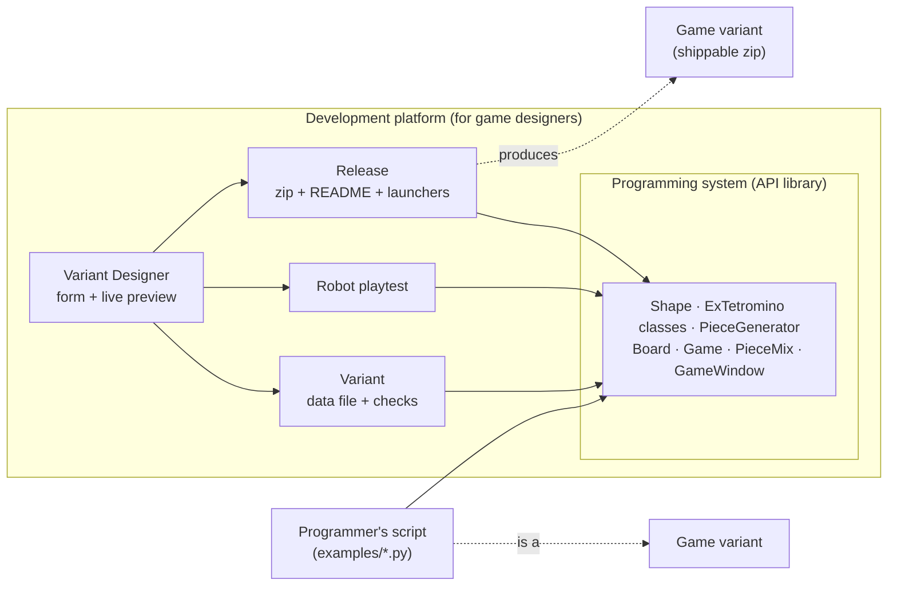
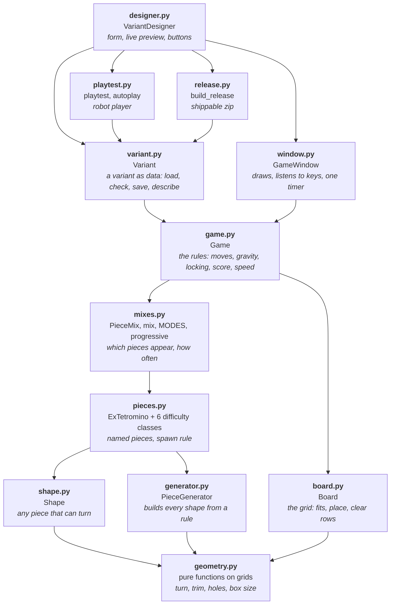
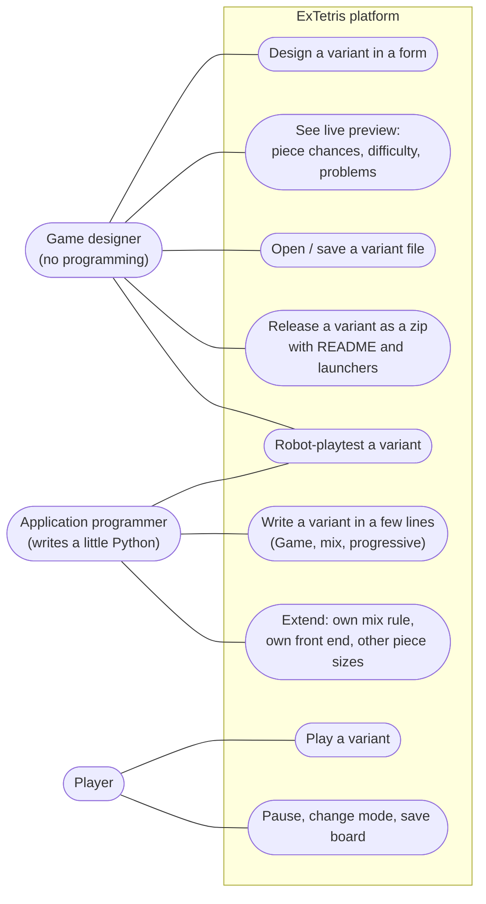
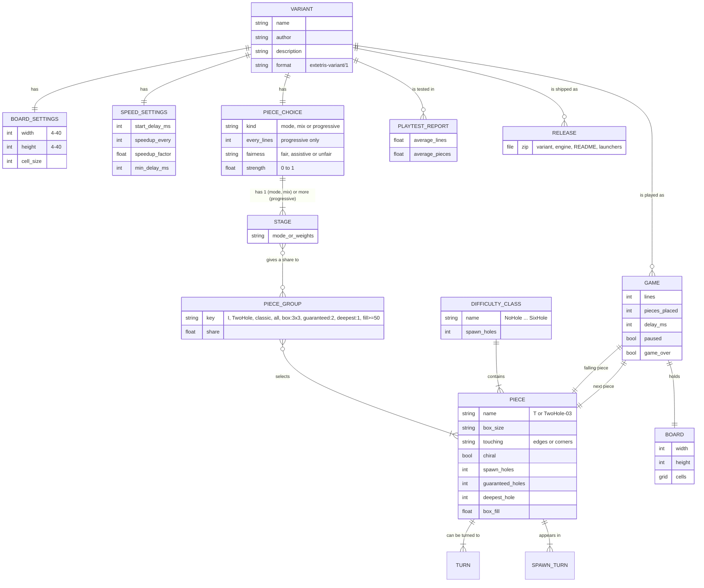
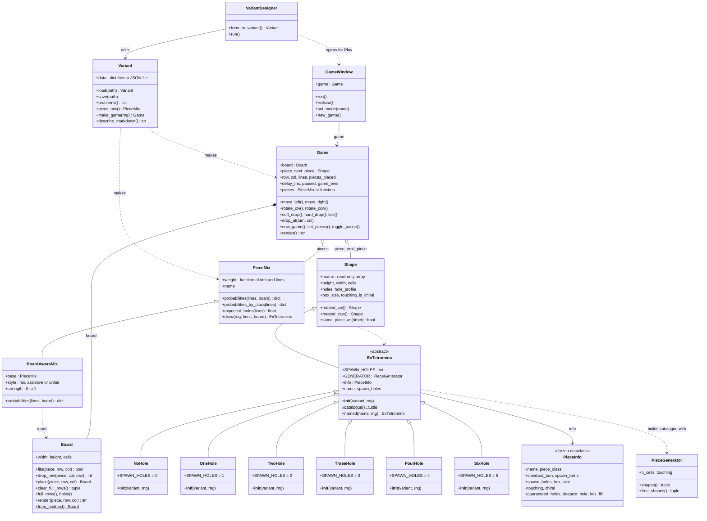
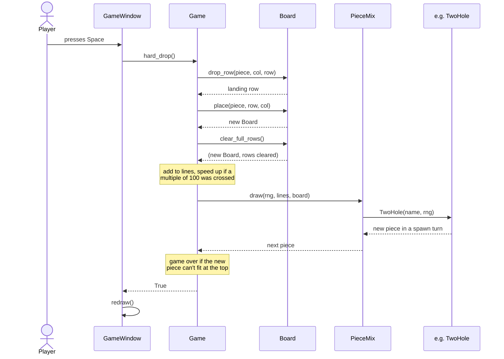

# ExTetris design document

This document explains how ExTetris in `src/extetris/` is put together and
why. The diagrams are written in [Mermaid](https://mermaid.js.org/), which
GitHub draws as pictures when you open this file there.

Related documents:

| document | what it covers |
|---|---|
| [analysis.md](analysis.md) | Phase 1: the starter shapes and the starter's bugs (B1–B10, D1–D3, L1–L8) |
| [api.md](api.md) | every public class and function (generated from the code) |
| [manual.md](manual.md) | the Game Programmer's Manual: how to make your own variant |
| [ai_log/raw_log.md](ai_log/raw_log.md) | the record of every AI prompt and response |

---

## 1. Goals (from the assignment brief)

1. **Pieces from a class hierarchy, not typed-in grids.** Pieces should be
   classified by shape, bounding box and the holes they leave when landing.
2. **A better way to set how often each piece appears.** This replaces
   "repeat an index in a list", in a functional-OO style.
3. **A non-programmer can design and release a variant** (the brief's "first
   and foremost requirement", compared there to Jupyter on Colab): no
   programming expertise needed, from design to a shippable game.

## 1a. What kind of product is this?

ExTetris is an **ExTetris Game Variant Development Platform that contains an
ExTetris Game Variant Programming System**. This is a subset–superset
relationship, like an IDE and the compiler inside it.

| part | what it is | where |
|---|---|---|
| **Programming system** | an API-equipped library: pieces, board, game rules, piece mixes. Programmers build variants by calling it, the way programs use BLAS. | `shape`, `pieces`, `generator`, `board`, `game`, `mixes`, `window` |
| **Development platform** | an environment for game designers, built on the system: **design** a variant in a form without code, **preview** it live, **check** it (plain-language problems), **test** it (robot playtester), **play** it, **document** it (generated README) and **package** it as a shippable zip | `variant`, `designer`, `playtest`, `release`, and the `design.*` launchers |
| **Game variants** | game-playing programs made *with* the platform or the system; they contain neither | `variants/*.json`, `examples/*.py`, every release zip |

## 2. The layers

The starter put everything (window, timers, rules, scoring, piece choice) into
one `TetrisEngine` class. ExTetris splits it into layers. Each layer only
uses the ones below it. The top row is the platform; the rest is the system.

Everything except `window.py` and `designer.py` works without tkinter. That's
why the rules can be checked by automatic tests (149 in total) and replayed
exactly from a random seed.

## 2a. Use cases: who uses ExTetris, and for what

Mermaid has no use-case diagram, so this is drawn as a flowchart in the same
style: people outside, the use cases inside the system boundary.

Two use cases include others: designing in the form always shows the live
preview, and releasing always saves the variant file.

| actor | needs | how ExTetris serves it |
|---|---|---|
| Game designer | make and ship a variant without code (the brief's "first and foremost requirement") | Variant Designer window, variant files, robot playtest, release zip ([manual §4](manual.md)) |
| Application programmer | shape a variant from Python without touching the engine | `Game(...)`, `mix`, `only`, `progressive`, `assistive`, `unfair` ([manual §5–7](manual.md), [api.md](api.md)) |
| Player | play it | `play.*` launchers or the launchers inside a release |

## 2b. Entity–relationship diagram

The things ExTetris keeps track of, and how they relate. A variant is the
only thing a designer saves; everything else is made from it or computed.

Reading it: `||--|{` means "exactly one … one or more", `||--o{` means
"exactly one … zero or more", and `}o--o{` means "many to many". PIECE and
DIFFICULTY_CLASS are not stored anywhere: the generator computes them each
run (section 5.1). The entities in the top half are exactly the fields of a
variant file ([variant.py](../src/extetris/variant.py)).

## 3. Class diagram

Reading the arrows: a hollow triangle means "is a kind of" (inheritance). A
filled diamond means "owns". A hollow diamond means "uses one it was given". A
dotted arrow means "depends on".

## 3a. The division of labour: who does what ("hair and limbs")

The brief's "Division of Labour" says the shape class provides the basic
dynamics of every piece, every ExTetromino inherits them, and the
constructor gets more complicated and is overridden in each subclass. This
is how that split was carried out. Each row is one layer of the hierarchy and
what it alone is responsible for.

| layer | its one job | what it adds ("hair and limbs") | what it inherits or delegates |
|---|---|---|---|
| `geometry.py` (pure functions) | the maths on grids | `freeze`, `trim`, `rotate_cw/ccw`, `mirror`, `distinct_rotations`, `holes`, `hole_profile`, `spawn_turns`, `guaranteed_holes`, `deepest_hole`, `box_size`, `box_fill`, `touching`, `is_chiral` | nothing: no classes, no state |
| `Shape` | **basic dynamics of any piece**, as in the brief | turns return a *new* shape (`rotated_cw`, `rotated_ccw`); read-only `matrix`; measures as properties (`height`, `width`, `cells`, `holes`, `hole_profile`, `box_size`, `touching`, `is_chiral`); `same_piece_as` | the maths, from `geometry` |
| `ExTetromino(Shape)` | **what makes a grid a game piece**: identity and the catalogue | `info` (a `PieceInfo`), `name`, `spawn_holes`; `catalogue()` (every piece, built once from the generator); `named("T")`; the shared constructor: pick a piece of this class by name, number or at random, then a spawn turn | all of `Shape`'s dynamics; builds pieces with `PieceGenerator` |
| `NoHole`, `OneHole`, `TwoHole`, `ThreeHole`, `FourHole`, `SixHole` | **one difficulty class each** | `SPAWN_HOLES` (the class's defining number); **its own `__init__`**, documenting the names and numbers it accepts; `SixHole.__init__` adds a rule of its own (only number 1 exists) | the shared constructor via `super().__init__`, and everything above |
| `PieceInfo` (frozen dataclass) | **facts about one piece**, whatever way it is turned | `name`, `piece_class`, `standard_turn`, `spawn_turns`, `spawn_holes`, `box_size`, `touching`, `chiral`, `guaranteed_holes`, `deepest_hole`, `box_fill` | made by `ExTetromino.catalogue()` |
| `PieceGenerator` | **produce every piece from a rule** instead of typing grids | `shapes()`, `free_shapes()` for any number of squares, touching on edges or corners | `geometry` |
| `Board` | **the grid and how pieces meet it** | `fits` (all four edges), `drop_row`, `place` (returns a new board), `full_rows`, `clear_full_rows`, `holes`, `render`, `from_text` | `geometry` |
| `PieceMix` | **which piece comes next, and how often** | one function *(piece info, lines) → weight*; `probabilities`, `probabilities_by_class`, `expected_holes`, `draw`; built by `mix`, `only`, `mode`, `progressive` | reads `PieceInfo`; never touches the board |
| `BoardAwareMix(PieceMix)` | **fair, assistive or unfair choice** | `probabilities(lines, board)` tries each piece on the board (`new_holes`) and moves the chances | its base mix's weights |
| `Game` | **the rules**, with no window | moves that return True/False, `tick`, `hard_drop`, `drop_at`, locking, line clears, speed-ups, pause, game over | `Board` for space, `PieceMix` for pieces |
| `GameWindow` | **drawing and keys only** | one timer, Canvas drawing, menus | everything from `Game` |
| `Variant` | **a whole variant as data** | `load`/`save`, `problems()` in plain words, `piece_mix()`, `make_game()`, `describe_markdown()` | builds a `Game` and a `PieceMix` |
| `VariantDesigner`, `playtest`, `build_release` | **the platform** | the form and preview; the robot player; the release zip | `Variant` and the API only |

**Where the starter's methods went.** The starter had one class,
`TetrisEngine`, doing all of this, plus `Shape` and `Board` with mutable
matrices:

| starter | now |
|---|---|
| `Shape.rotateCW`, `rotateAntiCW` (changed the matrix in place, and mirrored it when blocked) | `Shape.rotated_cw()` / `rotated_ccw()` return a new shape; `Game.rotate_cw()` tries it on the board and keeps it only if it fits, with wall kicks |
| `Shape.fliplr`, `flipud`, `transpose` | inside `geometry` (pure functions); not needed by callers |
| `Board.collision`, `insertShape`, `removeShape` | `Board.fits`, `Board.place` (new board); removing is never needed because placing doesn't change the old board |
| `TetrisEngine.move_piece`, `move_left/right`, `drop_piece`, `move_down_step` | `Game.move_left/right`, `soft_drop`, `hard_drop`, `tick` |
| row clearing inside `move_down_step` | `Board.clear_full_rows()` |
| `speed_up`, `slow_down` | `Game.speed_up`, `Game.slow_down`, plus `speedup_every`, `speedup_factor`, `min_delay_ms` as settings |
| `new_piece`, `get_any_extetromino(distribution)` | `PieceMix.draw` (or any `rng -> piece` function) |
| `render`, `update_step`, `create_menu`, key bindings | `GameWindow` |
| `Extetromino1` … `Extetromino73` (typed grids) | `PieceGenerator` + the six classes; **no grid is typed anywhere** |

**Additional methods with no starter equivalent:** `Board.drop_row` and
`holes`, `Shape.same_piece_as`, `ExTetromino.catalogue` and `named`,
`PieceMix.expected_holes` and `probabilities_by_class`, `new_holes`,
`Game.drop_at` (for the robot), `Variant.problems` and `describe_markdown`,
`playtest`, `build_release`.

## 3b. How the hierarchy takes work off the application programmer

The brief asks for a hierarchy that "allow[s] many flexibilities yet
requir[es] the application programmer no programming prowess", so they can
"focus on the game engine dynamics, not coding". The table compares what a
person has to do for the same change, in the starter and in ExTetris.

| they want | starter | ExTetris, no code (designer or variant file) | ExTetris, Python |
|---|---|---|---|
| classic Tetris | `TetrisEngine(range(1,8))`, knowing that indices 1–7 are the classics | pick mode "classic" | `Game(pieces="classic")` |
| more long bars | repeat index 1 (and 10, 11, which are also I) in a list | type a share next to "I" | `mix(classic=70, I=10)` |
| harder pieces after 10 lines | edit `TetrisEngine` | "Progressive", stages and "every 10 lines" | `progressive(["classic", "hard"], every_lines=10)` |
| only pieces that fit a 3×3 box | find which of 73 matrices qualify, list their indices | "Pick by shape" → box 3×3 | `mix({"box:3x3": 1})` |
| a game that helps (or bullies) the player | rewrite piece choice to read the board | "Reacts to the board" → assistive / unfair, strength | `assistive("normal", 0.8)` |
| a 14-wide board, faster start | edit `width` and timers in `__init__` | two fields | `Game(width=14, start_delay_ms=800)` |
| check how hard it is | play it | live preview + Robot playtest | `mix(...).expected_holes()`, `playtest(...)` |
| give it to someone | send the source folder | Release button → zip with README | `build_release(variant, folder)` |
| a new kind of piece choice | edit `get_any_extetromino` | not possible without code | write one function `(info, lines) -> weight` and wrap it in `PieceMix`, or subclass `PieceMix` |

What makes that possible:

1. **Pieces know their own properties.** Because every piece carries a
   `PieceInfo`, a programmer can choose pieces by *meaning* (class, box,
   holes, name) instead of by index. The hierarchy answers "which pieces are
   two-hole?" so they don't have to.
2. **Choosing pieces is one function.** Every way of choosing (a mode, a mix,
   stages, board-aware) is a `PieceMix`, which `Game` treats the same way. A
   programmer combines them instead of editing the engine.
3. **Objects can't be changed after they are made.** A programmer can pass
   shapes and boards around without worrying about the starter's shared-matrix
   bugs.
4. **Rules are separate from the window.** A programmer can change rules and
   test them without opening a window.
5. **The whole variant is data.** For the designer there is nothing to
   program; the form writes the file, and the same file drives play, the
   robot, the README and the release.

The three example scripts in `examples/` are 18–29 lines each, mostly
comments; the variant files in `variants/` have no code at all.

## 4. What happens when you press Space

## 5. Key design decisions

The student made each decision at a checkpoint after the trade-offs were laid
out. The discussion is recorded in the AI log.

### 5.1 Pieces: a generator plus a hierarchy of difficulty classes

Three hierarchies were considered:

- **A.** By bounding box.
- **B.** By the holes a piece leaves.
- **C.** A parameterised generator.

The design combines B and C:

- **C underneath.** `PieceGenerator(n_cells=4, touching="corners")` grows every
  shape one square at a time. It finds exactly the 34 rotation-distinct pieces
  that the starter's 73 hand-typed grids contain (checked by a test). It also
  works for other sizes; for example, 5 squares gives the 18 one-sided
  pentominoes. **No grid is typed in anywhere**, not even for I, O, T, S, Z, L
  and Γ: their names are worked out from their properties.
- **B on top.** The visible hierarchy is `NoHole`, `OneHole`, `TwoHole`,
  `ThreeHole`, `FourHole` and `SixHole`. No piece leaves exactly five holes, so
  there is no `FiveHole`. Each class pulls its members from the generator.
- **Bounding box and edge/corner touching** are properties each piece knows
  (`box_size`, `touching`), not classes. They can still be used to choose
  pieces, for example `PieceMix(lambda info, lines: info.box_size == "3x2")`.

Rules that decide a piece's class:

| decision | choice |
|---|---|
| Which turn decides the class? | The **spawn turn**. |
| What is the spawn turn? | The **flattest** turn; if tied, the one with **fewest holes**; if still tied, **a random one** of those. |
| Merge the rare classes? | No, they stay separate. |
| Names for non-classic pieces | Automatic: `<Class>-NN`, e.g. `TwoHole-03`. |
| Second level split by edges/corners? | Not now; it can be added later. |
| Constructors | **Each class overrides `__init__`**, as the brief asks. It documents what that class accepts and passes the shared work to `ExTetromino.__init__` with `super()`. `SixHole` adds its own rule ("there is only one six-hole piece"). |

The flattest-then-fewest-holes rule gives the same classes as "the turn with
the fewest holes possible". So a piece's class doesn't depend on which of the
two rules you think of.

| class | pieces | which |
|---|---|---|
| NoHole | 5 | I, O, L, T, Γ |
| OneHole | 10 | S, Z, OneHole-01 … 08 |
| TwoHole | 11 | TwoHole-01 … 11 |
| ThreeHole | 3 | ThreeHole-01 … 03 |
| FourHole | 4 | FourHole-01 … 04 |
| SixHole | 1 | SixHole-01 (the long diagonal) |

### 5.2 Nothing changes after it is made

`Shape` and `Board` are immutable. Turning a piece or placing it returns a
**new** object, and their grids are read-only numpy arrays. This makes the
starter's worst bugs impossible rather than just fixed:

- **B1, B2:** a blocked turn mirrored the piece and damaged the shared template.
- **B3:** every default `Shape` shared one array.

The `Game` is the one object that changes: it holds the current board and
piece. It can try a move on a new object and keep it only if it fits.

### 5.3 Piece frequencies: functions inside objects (functional-OO)

A `PieceMix` wraps a single function: *(piece info, lines cleared) → weight*.

- `mix()` and `only()` build that function from weights a designer writes.
- `MODES` holds ready-made mixes.
- `progressive()` builds a new function that picks a different mix depending
  on lines cleared.

Because mixes are just functions, they combine freely, and a programmer can
write a completely new rule in one line.

Compared with the starter's repeated index list:

- weights are written once per piece or group, not by repeating entries;
- they are named (`"T"`, `"TwoHole"`, `"classic"`), not index numbers;
- they mean what they say: the starter's list repeated some shapes up to 4
  times, so its "uniform" mix wasn't uniform;
- they can depend on how far the game has got.

Phase 9 (after the 6 Nov tutorial) added two things:

- **Property groups.** Mix keys can also select pieces by a measured
  property rather than a name: `box:3x3`, `guaranteed:2` (fewest holes in any
  turn), `deepest:2` (deepest one-column hole) and `fill>=50` (share of the
  bounding box filled). These are filters over `PieceInfo`, so no new
  classes were needed.
- **Board-aware mixes.** A plain mix sees only the lines cleared, so it can
  only make a *fair* game. `BoardAwareMix` is a `PieceMix` subclass whose
  `probabilities(lines, board)` also gets the board. It tries each candidate
  in every turn and column (`new_holes`) and moves the chances towards the
  pieces that fit best (*assistive*) or worst (*unfair*). `Game` passes its
  board when it draws; plain mixes ignore it, and plain `rng -> piece`
  functions still work.

| robot, 3 games of up to 200 pieces | fair | assistive | unfair |
|---|---|---|---|
| classic pieces: lines cleared | 73 | 78 | 48 |
| normal pieces: lines cleared | 19 | 73 | 0 |

One check gave an unexpected answer: for every 4-square piece the
**guaranteed holes equal the spawn-turn holes**, because the spawn rule
already picks a turn with the fewest holes. So the "guaranteed holes"
grouping matches the difficulty classes exactly. It only differs for other
sizes: 8 of the 166 five-square pieces leave fewer holes in their best turn
than in their spawn turn.

### 5.4 Variants are data, not code (platform)

A variant is a small JSON file: name, board, speed, pieces (a mode, a mix of
shares, or progressive stages). `Variant` turns it into a `Game`, and its
`problems()` method lists everything wrong in plain words. The designer shows
those problems live and blocks Play, Robot playtest and Release until there
are none.

Because a variant is data:

- the designer can read and write it;
- a release zip carries it next to a copy of the engine;
- the README inside the release is generated from it, so the documentation
  always matches the game.

The robot playtester uses the system API (`Game.drop_at`) and a simple
well-known scoring rule (aggregate height, cleared lines, holes, bumpiness).
It gives designers a number to compare variants by. With 3 games of up to 200
pieces it cleared about 73 lines on classic, 19 on normal and 2 on chaos.

### 5.5 Rules separate from the window

`Game` has no tkinter in it. `GameWindow` only draws and forwards keys. Results:

- tests can play thousands of random moves in a fraction of a second;
- a seeded game replays exactly;
- another front end (a terminal version, a web version) could reuse `Game`
  unchanged.

## 6. Starter problems and where they were fixed

| starter problem ([analysis.md](analysis.md)) | fixed in | how |
|---|---|---|
| B1/B2 shared matrix in rotation, mutated templates | `shape.py`, `geometry.py` | immutable pieces, rotations return new objects |
| B3 shared default array | `shape.py` | every input is copied and frozen |
| B4 off the left/top edge wraps around | `board.py` | `fits()` checks all four edges explicitly |
| B5 `pasueStatus` typo | `game.py`, `window.py` | one `paused` flag; dialogs restore it |
| B6 extra timers while paused | `window.py` | one timer, cancelled before rescheduling |
| B7 `game_over_status` never set | `game.py` | `game_over` set on a failed spawn; New Game resets |
| B8 speed-up skipped by multi-line clears | `game.py` | counts every multiple of 100 crossed |
| B9 `eval` and crash-prone input | `pieces.py`, `mixes.py` | pieces looked up by name, clear errors |
| B10 rows wrap and misalign | `board.py`, `window.py` | one character per square; Canvas drawing |
| D1/D2 imports that worked by accident | all modules | every module imports what it uses |
| L1 rotation pivots on a corner, no wall kicks | `game.py` | turns stay centred; kicks of 0, ±1, ±2 columns, then 1 row up |
| L2 no anticlockwise key | `window.py` | Z key |
| L3 hard drop doesn't lock | `game.py` | `hard_drop()` locks immediately |
| L4 one class does everything | whole package | layers (section 2) |
| L5 deep copy every 100 ms | `window.py` | redraw only after a change |
| L8 weights are index repeats | `mixes.py` | `PieceMix` (section 5.3) |

## 7. Testing

`python3 -B -m unittest discover -s tests -v` runs 149 tests in about 12 seconds.
They check:

| test file | what it checks |
|---|---|
| `test_pieces.py` | counts match Phase 1 (34 / 22), the generated set equals the starter's, class sizes, spawn rule, names, immutability, per-class constructors |
| `test_board.py` | edges (B4), placing, dropping, clearing rows, holes (cross-checked against every piece), drawing (B10) |
| `test_game.py` | moves, wall kicks, locking, speed-ups (B8), pause, game over (B7), 3000-move random play, seeded replay, one window timer (B6) |
| `test_mixes.py` | weights, names, groups, modes ordered by difficulty, progressive stages, 5000-draw frequency check, Game integration |
| `test_examples.py` | every example variant and every code snippet in the manual still works |
| `test_tutorial.py` | Phase 9: guaranteed holes, deepest hole, box fill, property groups, board-aware mixes (assistive avoids pieces that don't fit, unfair picks them, strength, the game passes its board, the robot finds unfair harder), fairness in variant files |
| `test_platform.py` | variant files (round trip, defaults, 12 kinds of problem), robot player (rules, ranks classic above chaos, repeatable), release zip (contents, permissions, line endings, unzipped `play.py --check` / `--info` actually run), designer window (form → variant, sliders, stages, open/save/release, Play) |

## 8. Known limitations and possible extensions

- **Rotation system.** Wall kicks are a simple fixed list, not a full rotation
  standard. Some turns next to other pieces are refused where a fuller system
  would allow them.
- **No hold piece, no ghost piece, no next-piece picture.** The next piece is
  named in the status line only.
- **Score = lines cleared**, as in the starter. Points per multi-line clear
  could be added in `Game._lock`.
- **Speed-up every 100 lines** (starter default) is rarely reached in normal
  play. It's one parameter: `Game(speedup_every=...)`.
- **Mode weights** are first choices. `hard` (1.76 average spawn holes) is
  close to `chaos` (1.85).
- **Saved boards** are text pictures only; they can't be loaded back.
- **Board-aware choice happens one piece early.** The next piece is chosen
  when the one before it appears (so it can be shown as "next"), so it is
  judged on the board without the falling piece.
- **Assistive/unfair look one move ahead only** and count holes only, not
  height or lines cleared.
- **Sizes other than 4 squares.** The generator supports them, but the
  difficulty classes are defined for 4-square pieces.
